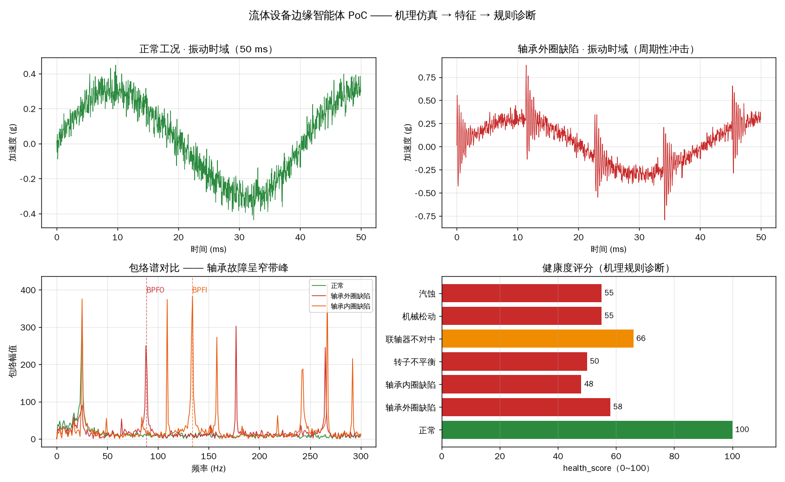
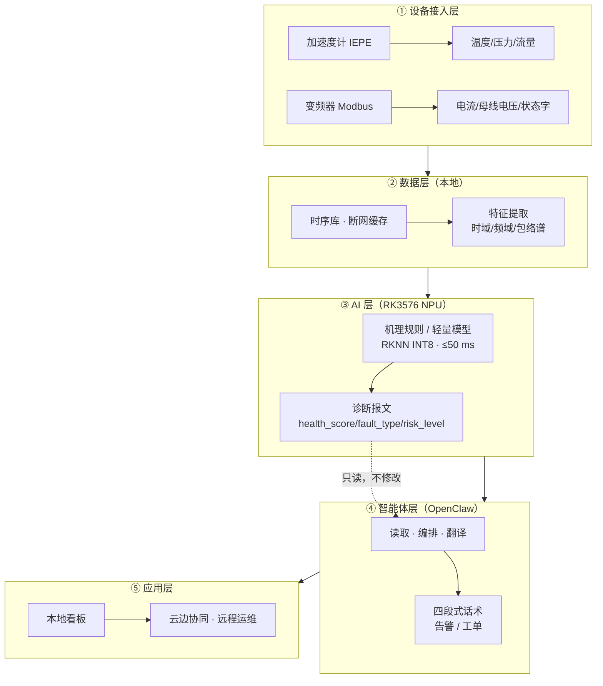

# 流体设备边缘智能体 · Fluid Equipment Edge Agent

> 让风机、水泵、压缩机"**会诊断、会省电、会说话**"——一台跑在国产边缘盒子
> （RK3576 · 6 TOPS NPU）上、基于 [OpenClaw](https://github.com/openclaw/openclaw)
> 编排的**设备专用工业智能体** PoC。
> **断网可用 · 数据不出场 · AI 只预警不下令**



**⚠️ 先说清楚：这不是一个通用边缘计算平台，也不是一个节能计算器。**
它把「**设备机理 + 现场经验 + 边缘推理 + 智能体编排**」串成一条可跑通的链路，
面向的是**流体机械（泵/风机/压缩机）这一垂直品类**的智能配套。

> 我们不是从算法开始的。团队在流体设备的**节能改造与运行诊断**上交付过真实项目
> （锅炉给水泵、矿井三泵房排水、干熄焦余热锅炉给水泵、锅炉风机），节电率与回收期均经业主验收；
> 盒子里的能效算法与这些方案**同口径**，同一把尺子、可现场复核。
> 对外统一话术见 [`docs/话术规范_v1.md`](docs/话术规范_v1.md)。

---

## 30 秒跑起来（零数据依赖）

```bash
pip install -r requirements.txt
python3 demo/run_demo.py
```

无需下载任何数据集——仓库内置**旋转机械机理仿真**，直接生成 7 类典型工况
的振动信号并走完整条诊断链路：

```
仿真工况        诊断结论        健康度   风险      命中
正常           正常             100    normal   ✅
轴承外圈缺陷    轴承外圈缺陷       58    high     ✅
轴承内圈缺陷    轴承内圈缺陷       48    high     ✅
转子不平衡      转子不平衡         50    high     ✅
联轴器不对中    联轴器不对中       66    medium   ✅
机械松动       机械松动           55    high     ✅
汽蚀          汽蚀              55    high     ✅
→ 命中率 7/7
```

输出物：
- `demo/out/demo_chart.png` —— 时域 / 包络谱 / 健康度四联图
- `examples/diagnosis_sample.json` —— 契约格式诊断报文
- 控制台打印现场工人可读的**四段式话术**（结论/依据/建议/风险）

---

## 它解决什么问题

流体设备（泵、风机、压缩机）在电厂、矿山、化工、市政中 7×24 运行，
现实痛点有三：

| 痛点 | 本项目做法 |
|:---|:---|
| **非计划停机** | 振动/电流/温度多信号融合，输出**健康度评分 + 故障类型 + 风险等级**，把"事后抢修"变成"提前检修" |
| **能耗说不清** | **工况识别 + 能效趋势 + 基线对比**，让"改不改、改多少"有实测依据 |
| **售后诊断靠人** | 设备侧边缘盒子本地推理，**断网可用**，现场自然语言问答，把经验沉淀成 7×24 在线的"设备医生" |

对**设备厂**：整机从"卖设备"升级为"**卖设备 + 智能服务**"（差异卖点 + 可持续的服务收入）。
对**终端用户**：**少停机、少耗电、少扯皮**——隐患提前发现、能耗有据可查、节能量可复核可存证。

**壁垒**：设备机理 + 现场失效经验 + 边缘推理 + **与节能测算同口径的算法**——做"设备专用"，不做通用平台。

**差异化**：状态监测 × 能耗显示 × 节能确权——把设备健康和节能量，都变成**可复核、可存证、可分成**的数据。

---

## 系统架构



**关键分工（三条硬约束，见 [`docs/safety-boundary.md`](docs/safety-boundary.md)）**：

1. **诊断模型层负责"判"** —— 故障类型 / 健康度 / 风险等级 / 寿命，只由模型输出；
2. **智能体层负责"说与做"** —— OpenClaw 只读取、编排、翻译，**不得自行推断故障**；
3. **不下高危指令** —— 停机 / 切泵只"建议并等待人工确认"，安全保护归设备既有系统。

---

## 诊断报文契约（冻结）

诊断模型的输出是**单一事实源**，字段一经冻结不得随意增删：

```json
{
  "schema_version": "1.0",
  "ts": "2026-10-05T16:22:58+08:00",
  "device_id": "PMP-01 注水A泵",
  "health_score": 58,
  "fault_type": ["bearing_outer"],
  "confidence": 0.84,
  "risk_level": "high",
  "remaining_life_days": [7, 30],
  "key_evidence": [
    {"metric": "bpfo_prom", "value": 35.1, "baseline": 2.3, "deviation": 14.3,
     "window": "1s窗", "unit": "×中位数"}
  ],
  "suggestion_hint": "check_drive_end_bearing",
  "model_version": "fluid_diag_rulebased_v0.1",
  "degraded": false
}
```

- 10 个必填 + 2 个可选字段
- 故障类型受控枚举（14 项）、健康度 → 风险 5 档映射
- 完整规范见 [`docs/diagnosis-contract.md`](docs/diagnosis-contract.md)

---

## 技术选择说明（为什么这么做）

| 选择 | 原因 |
|:---|:---|
| **机理规则先于深度学习** | 现场真实失效样本稀缺（复现故障要停机），深度模型冷启动没数据；先用可解释规则 + 无监督检测顶上 |
| **包络谱峰"突出度"作核心判别器** | 轴承缺陷呈**窄带**包络（峰极突出），汽蚀呈**宽带**（峰不突出）——只看总能量会把这俩混淆 |
| **只用 numpy（无 scipy/sklearn）** | 边缘盒子上无重型依赖，特征维度 <20，便于后续 INT8 量化上 NPU |
| **仿真信号而非数据集** | 零数据依赖、开箱即跑、可复现；同时体现"设备机理"这一壁垒 |

---

## 路线图

| 阶段 | 状态 | 内容 |
|:---|:---:|:---|
| **一 · PoC 与展示** | 🚧 进行中 | 机理仿真 → 诊断链路 → 契约报文（本仓库） |
| **二 · 高校实训** | 📋 规划中 | 边缘计算实训室：样机箱 + 实验套件 + 课程/实验指导书 |
| **三 · 现场配套落地** | 📋 规划中 | 风机/水泵/压缩机现场验证 → 可报价的边缘盒子配套产品 |

> 阶段二、三**尚无公开案例**，将在首个现场验证完成后补充实测数据。

---

## 目录结构

```
fluid-edge-agent/
├── src/
│   ├── signal_sim.py    # 旋转机械机理仿真（轴承特征频率 + 冲击串 + 各工况）
│   ├── features.py      # 时域/频域/包络谱特征提取（纯 numpy）
│   ├── health.py        # 机理规则诊断：健康度/故障类型/置信度/风险等级
│   ├── diagnose.py      # 诊断主入口 → 契约化 JSON 报文
│   └── agent.py         # 智能体层：报文 → 四段式现场话术（只读，不推断）
├── demo/run_demo.py     # 一键演示（文本 + 图表 + 报文）
├── docs/                # 架构 / 契约 / 安全边界 / 路线图
├── examples/            # 示例诊断报文
└── assets/              # 演示图
```

---

## 边界与声明

- ⚠️ **仿真数据**：本仓库用机理仿真的振动信号演示算法链路，**不能替代现场标定**；
  所有阈值（`src/health.py` 中 `TH`）均为演示值，投产前必须用现场实测基线替换。
- ⚠️ **安全边界**：系统只做"预警 + 建议 + 辅助决策"，**不下发停机/切泵等控制指令**；
  硬保护回路由设备既有安全系统负责。
- ⚠️ **数据合规**：现场数据本地处理、不出场。
- 📄 **协议**：暂未指定开源协议（含商业资产，未经授权请勿商用）。如需引用/合作请联系。

---

## 合作与联系

本项目面向**高校共建（边缘计算实训室）**与**设备厂 / 终端用户（智能配套）**。
有意向欢迎开 Issue 或直接联系项目维护者。
