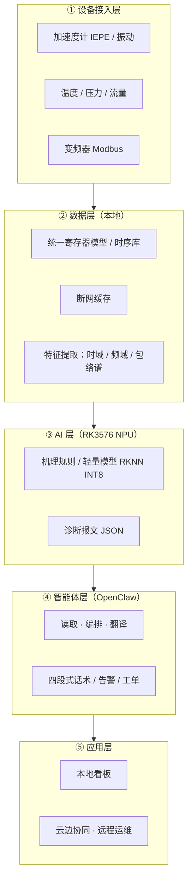

# 系统架构

> 五层架构：设备接入 → 数据 → AI → 智能体 → 应用。
> 自上而下**只能读取**、不反向修改，保证诊断结论的唯一来源。

## 一、总览

## 二、各层职责

| 层 | 承担者 | 输入 | 输出 | 实时性 |
|:---|:---|:---|:---|:---|
| ① 接入 | 嵌入式/工控服务 | 变频器 Modbus、压力/温度/振动传感器 | 标准运行数据表 | 秒级，7×24 |
| ② 数据 | 边缘服务 | 原始数据 | 特征向量（时域+频域+趋势） | 秒级 |
| ③ AI | RKNN 轻量模型 / 机理规则 | 特征向量 | 健康度、故障类型、置信度、风险等级、寿命区间 | 单次推理 ≤ 50 ms |
| ④ 智能体 | OpenClaw + 本地小模型 + 机理知识库 | 诊断报文 + 实时数据 + 设备档案 | 话术、建议、工单、告警 | 秒级应答，断网可用 |
| ⑤ 应用 | 看板 / 云边协同 | 结构化输出 | 可视化、远程运维 | 分钟级 |

## 三、数据流与采集周期

| 数据 | 来源 | 周期 |
|:---|:---|:---|
| 变频器（频率/电流/母线电压/状态字/故障码） | Modbus | **1 s** |
| 压力/流量 | RS485 | **1 s** |
| 温度（轴承/电机/介质） | 传感器 | **10 s** |
| 振动（输出特征，原始采样 ≥ 10 kHz） | IEPE | **10 s** |

> 原始高频振动数据不长期落盘：**边缘提取特征，只回传异常片段**
> （边缘盒子存储有限，eMMC 根分区通常仅剩数十 GB）。

## 四、本仓库实现的边界

本仓库（PoC）覆盖 **②特征提取 → ③机理规则诊断 → ④智能体话术** 三段，
用**机理仿真信号**替代 ①接入层的现场数据，用**规则诊断器**替代训练好的
RKNN 模型（两者接口一致，可平滑替换）。

未实现（需现场条件）：真实传感器驱动、Modbus/RS485 采集、
模型训练（需 GPU，盒子只能推理）、云边协同。
